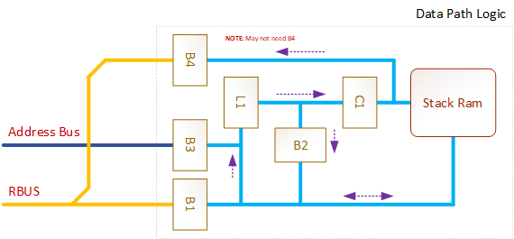

# Stack Pointer Overview #

**DRAFT** - 2026-10-28

This project uses a 16-Bit stack but unlike other projects, the stack is not part of normal user RAM, instead it is implemented as a separate "Functional Unit".

One of the advantages of this is a register value can be PUSHed or POPed to/from the SP relatively independant of other operations and in effect parts of the operation can be done in parallel with other tasks.

The transfer of register contents to and from the SP takes place over the [RBUS](/Registers/RBUS.md). 

## Theory of operation ##

### Reset ###

When a RESET occurs, the SP initializes back to 0x0000. The RSP instruction can also be used to reset the SP back to 0x0000.

### PUSH ###

When a [PUSH](/ISA/PUSH.md) instruction is executed the basic process needed is:

- The register controller presents the data on the RBUS then
- The SP Controller:
  - Increments the SP Counter (C1)
  - Sets the B1_DIR to input and enables the B1_OE so the value presents on the internal data bus of the SP.
  - Latch the data via B1 into the SP Latch L1
  - Disabled the B1 buffer
  - Enables the B2 Buffer
  - Asserts RAM_CS, RAM_WE
  - De-asserts RAM_CS and RAM_WE (Writes the data on the railing edge).

### POP ###

The [POP](/ISA/POP.md) instruction will cause the current SP RAM data to be made available on the RBUS so it can be latched back into the required register (including the PC register).

- Buffer B1_DIR is set to output.
- RAM_CS and RAM_OE are asserted.
- B1_OE is enabled.
- Data is now present on RBUS for the Register Controller to capture.

## Internal Design ##

### Functional Blocks ###

- B1 - Buffer between RBUS and the internal SP BUS
- L1 - Latch for internal Bus to Counter (C1)
- C1 - Counter 12-bit counter
- B2 - Latch Buffer, buffer between Latch output side and internal Bus.
- B3 - Address Bus input Buffer to internal Bus (CALL / RET data).

### Signals ###

- B1_DIR - Set B1 to input or output.
- B1_OE - Output Enable.
- L1_LATCH - Latches the internal buffer.
- B2_OE - Enables output from the Buffer (present L1 data back to internal bus).
- B3_OE - Enables output from the B3 buffer (present address bus to internal bus).
- RAM_CS - RAM Chis Select
- RAM_WR - Enables writing to the RAM
- RAM_OE - Enables the RAM output buffers (READ Mode)
- C1_RESET - Reset the Counter back to 0x0000
- C1_LOAD - Load the L1 output
- C1_INC - Increment the counter by 1
- C1_DEC - Decrement the counter by 1

## Relevant Instructions ##

* [PUSH](/ISA/PUSH.md) <Rs>
* [POP](/ISA/POP.md) <Rd>
* [RSP](/ISA/RSP.md)
* [PUSHF](/ISA/PUSHF.md)
* [POPF](/ISA/POPF.md)
* [CALL](/ISA/CALL.md)
* [RET](/ISA/RET.md)
* [LDSP](/ISA/LDSP) <Rd>
* [STSP](/ISA/STSP) <Rs>

Within the ISA, these instructions are grouped together and they operate on a source Register. If an Immediate value needs to be pushed then it must be moved into a Register and then PUSHed to the stack.

- The PUSHF and POPF instructions work on the flags register only.
- The RSP instruction is used to reset the SP back to 0xFFFF.
- The LDSP instruction will load the actual SP counter value (RAM address) into the specified destination Register.
- The STSP instruction will save the value in the source register into the SP counter.
- The CALL instruction will save the PC value into the SP RAM
- The RET instruction will return the top stack value, presenting it to the B4 latch.

## Interrupts ##

If an interrupt is generated and executes, the current PC value is automatically pushed onto the stack first.

## CALL / RET Login ##

< todo >

## Instruction Decoding ##

< todo >

Updated: 2026-10-28
